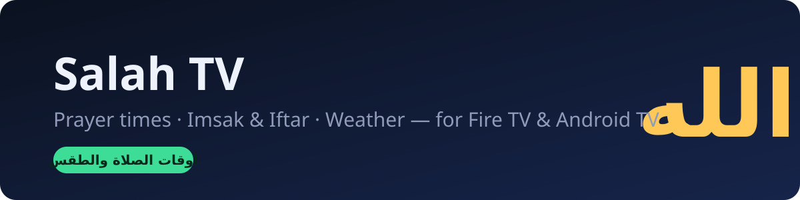
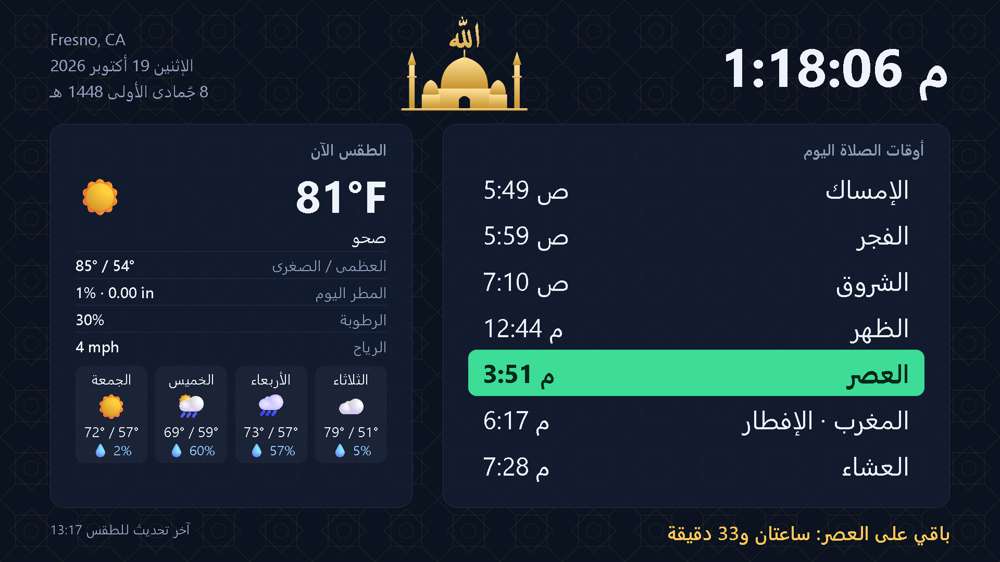

<p align="center"></p>

<p align="center">
  <a href="https://alimwork85-web.github.io/salah-tv/"></a>
  
  
  
  <a href="LICENSE"></a>
</p>

# Salah TV — أوقات الصلاة والطقس على شاشة التلفاز

صفحة واحدة بالعربية مصمّمة لشاشة التلفاز (Fire TV / Android TV)، تُفتح في متصفح مثل **TV Bro**، فيها:

- **ساعة كبيرة** مع التاريخ الميلادي والهجري.
- **أوقات الصلاة اليوم** (طريقة ISNA لأمريكا الشمالية)، مع تمييز الصلاة القادمة وعدّاد تنازلي لها.
- **الإمساك والإفطار**: يظهران تلقائيًا في رمضان، مع عدّاد «باقي على الإفطار» و«باقي على الإمساك».
- **الطقس بالمقاييس الأمريكية** (°F وmph والبوصة): الطقس الآن، والعظمى والصغرى، واحتمال المطر، والرطوبة، والرياح، **وتوقعات 4 أيام**.
- **تأثير مطر متحرك** على الشاشة حين تمطر فعلًا.
- **تنبيه ذهبي عند دخول الوقت**: يتحول صف الصلاة إلى ذهبي نابض، ويظهر «حان الآن وقت صلاة …» لمدة 15 دقيقة.
- **الأذان بالصوت** عند دخول وقت كل صلاة. إن منع المتصفح الصوت التلقائي ظهر «اضغط OK لتفعيل صوت الأذان»، فتكفي ضغطة واحدة بعد فتح الصفحة.
- خلفية بنقش هندسي إسلامي، ورسم مسجد وهلال أصلي.
- أرقام غربية (0-9) في كل مكان.

<p align="center"></p>

## الاستخدام

افتح الرابط على التلفاز: **https://alimwork85-web.github.io/salah-tv/**

| الرابط | النتيجة |
|---|---|
| `…/salah-tv/` | تلقائي: الإمساك والإفطار يظهران في رمضان فقط |
| `…/salah-tv/?ramadan=1` | إظهار الإمساك والإفطار دائمًا |
| `…/salah-tv/?ramadan=0` | إخفاؤهما دائمًا |
| `…/salah-tv/?rain=1` | معاينة شكل المطر |
| `…/salah-tv/?at=12:43` | تشغيل الساعة من وقت معيّن لمعاينة التنبيه والأذان |

على Fire TV مع TV Bro يمكن فتحها من الكمبيوتر بأمر واحد:

```
adb shell am start -a android.intent.action.VIEW -d "https://alimwork85-web.github.io/salah-tv/" com.phlox.tvwebbrowser
```

## تغيير المدينة

عدّل السطر `const LAT = …, LON = …;` في `index.html` واسم المدينة في `#date`.
المدينة الافتراضية **Fresno, CA**.

## مصادر البيانات

- أوقات الصلاة: [Aladhan API](https://aladhan.com/prayer-times-api) — `method=2` (ISNA).
- الطقس: [Open-Meteo](https://open-meteo.com/) — مجاني ولا يحتاج مفتاحًا.
- الأذان: [The Adhan – Aaqib Azeez](https://commons.wikimedia.org/wiki/File:The_Adhan_-_Muslim_Call_to_Prayer_-_Aaqib_Azeez.mp3)، بصوت Aaqib Azeez وبرفع Atcovi، من Wikimedia Commons. رخصته [CC BY-SA 4.0](https://creativecommons.org/licenses/by-sa/4.0/)، والملف `assets/adhan.mp3` يبقى تحت هذه الرخصة نفسها.

لا تجمع الصفحة أي بيانات عن المستخدم، ولا تستخدم كوكيز.

---

**Salah TV** — a single-file Arabic prayer-times, Imsak/Iftar and weather (US units) dashboard for Fire TV and Android TV browsers.

## المطوّر والناشر

**Ali Alhumedi** — © 2026 Ali Alhumedi. الترخيص: [MIT](LICENSE).
